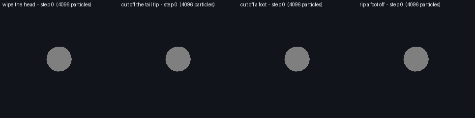
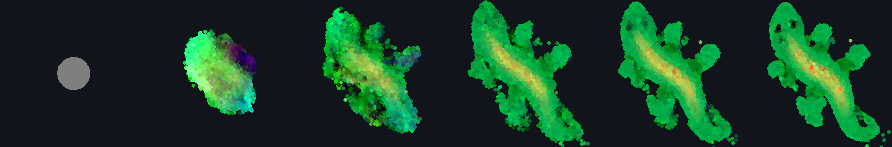

# Neural Particle Automata (Phase 3, particle version)

A reimplementation of [Neural Particle Automata: Learning Self-Organizing Particle Dynamics](https://arxiv.org/abs/2601.16096) (Kim, Pajouheshgar, Süsstrunk, Jakob, Park, 2026), written to answer one question for this project: **does a swarm of moving particles, each running the same tiny network with only local sensing, grow a shape and repair it?** The 2D lizard experiment is the part that matters for microbots, so that is what this covers.



*Left to right: wipe the head, cut off the tail tip, cut off a foot, rip a foot off. 4,096 particles, 240 steps after the damage. Made by `repair.py`.*

## What was checked, and what was not

The short version: **the swarm grows the lizard and repairs colour damage and small lost limbs. It does not repair a cut tail tip, and a piece torn far from the body stays stranded.** Details below.

| Claim | Status |
| --- | --- |
| Our code implements the paper's rule | Checked. With the authors' pretrained lizard it grows the lizard from a seed (below), and the maths passes the properties the paper claims (`checks.py`: rescaling space and ε leaves the dynamics unchanged, the rule ignores where the swarm sits, the gradient of a linear field is recovered). |
| The JavaScript demo matches the Python | Checked to float32 precision: 2e-6 in state after 1 step, 2e-5 after 5. |
| The swarm grows the lizard | Checked at 4,096 particles with the authors' weights. |
| The swarm repairs damage | Partly. See the table below. |
| **Training from scratch works** | **Not checked.** `train.py` follows the paper's recipe and runs end to end (the loss falls on a fixed batch in `checks.py`, and 3 real iterations at 1,024 particles ran), but it was never run to convergence. Measured on a Raspberry Pi 4: about 51 s per iteration at 1,024 particles and batch 2. The published recipe is 30,000 iterations at batch 8 and 4,096 particles, so it needs a GPU. |
| **A model trained at 1,024 particles with ε = 0.2** | **Not done**, for the same reason. What was run instead is the authors' 4,096-particle model on 1,024 particles (below). |
| Paper's numbers | There are none to compare against. The paper reports no loss, IoU or regrowth score for the lizard, only figures and timings on a GPU. So "reproduced" here means qualitatively reproduced. |

### Growing (baseline: 4,096 particles, ε = 0.1, the authors' lizard weights)



Steps 0, 16, 32, 64, 96, 160. The footprint overlap with the target (IoU) goes 0.14 → 0.44 → 0.71 → 0.85 → 0.86 → 0.88. The loss terms are the paper's (`target.py`): density loss 2.56 → 0.059, colour loss 0.024 → 0.016. A few stray particles drift off the tail tip.

### Repairing

Each run grows the lizard for 200 steps, damages it once, then runs 240 more steps. The undamaged control reaches IoU 0.891 at that point (it keeps improving slowly), so that is the number to compare against, not the 0.867 before the damage. One run per row, no error bars.

| Damage | Particles removed | IoU just after | IoU 240 steps later | What the pictures show |
| --- | --- | --- | --- | --- |
| Wipe the head's state (what training uses) | 0 | 0.870 | 0.888 | **Repaired.** Colour and eyes return within ~20 steps. |
| Cut off a foot | 57 | 0.850 | 0.868 | The foot appears to grow back (judged by eye from the frames; the IoU change is small). |
| Rip a foot off (displace its particles 0.3 away) | 0 | 0.846 | 0.869 | The body appears to grow a new foot, but the torn-off piece stays stranded: it has no neighbours within ε, so it senses nothing and never rejoins. |
| Cut off the tail tip | 203 | 0.741 | 0.781 | **Not repaired.** The tail ends in a blunt stub and the curl never returns. |

IoU hides some of this (the stranded blob barely moves it), so look at `results/repair_*.png`. The model was trained only against state wipes, so cutting and ripping are outside what it learned. The rule also has no way to create particles, so a cut can only be refilled by the remaining ones spreading out.

At 1,024 particles (the 4,096-particle model run on a quarter of the particles, so about 30 neighbours each instead of 120) the lizard is coarser and lumpier but recognisable, and a wiped head recolours. The control scores IoU 0.73 → 0.76 against 0.87 → 0.89 at 4,096. The cut and drag scores follow the same pattern as above; only the wipe picture was inspected (`results/repair_N1024_*.png`).

## Try it

Setup is the repo's usual (see the root README), then:

```bash
python phase3/npa/checks.py                      # the maths, JS-vs-JAX, trainer smoke test (~2 min)
python phase3/npa/export_web.py --fetch-paper    # builds the web demo's weights (see "Licence" below)
python -m http.server -d phase3/npa/web 8000     # then open http://localhost:8000
```

The page also opens straight from disk (double-click `web/index.html`). Drag on the lizard with the eraser, scissors or grab tool, or use the one-click buttons, and watch what grows back.

| File | What it is |
| --- | --- |
| `npa.py` | The model in JAX: SPH operators, perception, the MLP, one step, rollouts |
| `target.py` | The lizard target and the loss (density and colour, compared as splatted images) |
| `weights.py` | Reads and writes weights: `.npz`, the authors' `.pth` (read as raw numbers, never unpickled), and the demo's `.js` |
| `baseline.py` | Grow, wipe the head, regrow, in JAX (slow: ~3 s per step at 4,096 particles on a Pi) |
| `repair.py` | The damage experiments above, using the fast JS engine; writes `results/` and the GIF |
| `train.py` | The paper's training recipe (pool, damage, normalised gradients, Adam), for a GPU or a lot of patience |
| `export_web.py` | Builds `web/target.js` and the weights for the demo |
| `checks.py` | Checks, in the same style as the other phases |
| `web/npa.js` | The model in plain JavaScript with a spatial hash grid; also runs in Node |
| `web/index.html` | The demo page |
| `web/headless.js`, `web/parity.js` | Run the engine without a browser; compare it with JAX |
| `data/lizard_u1f98e.png` | The target: the Noto Emoji lizard (Apache-2.0) |

Speed: the JS engine does about 4 steps per second at 4,096 particles on a Raspberry Pi 4 (a Cortex-A72), and a laptop should manage many times that. The demo's speed slider caps the rate and it spends at most ~14 ms per frame stepping.

## Licence of the authors' weights

The authors' repository ([TheDevilWillBeBee/NPA](https://github.com/TheDevilWillBeBee/NPA)) has no licence file, so their pretrained `lizard.pth` is not committed here and `*.pth` is git-ignored. `export_web.py --fetch-paper` downloads it onto your machine and converts it; the result (`web/weights/lizard_paper.js`) is ignored by git too. This code was written from the paper's equations. The authors' code was read only to settle details the paper leaves open (kernel sign conventions, normalisation, loss weights) and none of it was copied. If you want to ship the demo with the pretrained weights on a website, ask the authors for permission or a licence first; until then the demo will not work out of the box from a fresh clone.

## Differences from the paper's setup

- **Neighbour search** is brute force in JAX (an N × N matrix) and a spatial hash grid in JS. The authors use custom CUDA kernels.
- **The seed** is a disc of radius 2ε with zero state, as in the paper's configuration for 4,096 particles.
- **`train.py`** compares the splatted images at 128 × 128 by default to save CPU time (the paper's config uses 256). `target.py` uses 256 for every number reported here.
- **The target** is today's Noto Emoji lizard, sampled to 4,111 points. The authors' loader points at an emoji URL that no longer exists, and Noto may have redrawn the emoji since the paper.
- **Unknown details.** Where the paper gives no value (the log-compression constant, the gradient-correction threshold) the code uses a plain choice and says so in a comment.
