# Progress: from dots to 3D bots

How the swarm project got from a single random walk to linked 3D bots that build, repair themselves and run a trained model. Oldest first. The full code and notes for each step are linked under its picture.

---

## 1. Dots, wandering (Phase 0, Oct 22)

1,000 dots, each taking random steps in 2D. Nothing smart yet: this is the "physics" every later bot is built on, written twice (NumPy, then JAX so it can run on a GPU later).
[Code](phase0/) · [Chapter 0](textbook/00-random-walk.md)

## 2. A flock that steers itself (Phase 1, Oct 22)

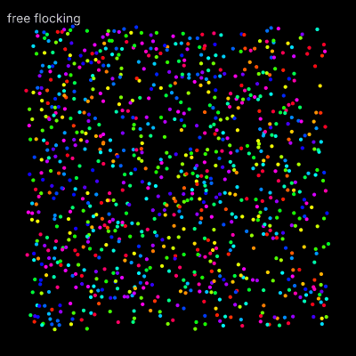

1,000 bots that only look at their neighbours: stay close, don't collide, face the same way. No leader, yet the whole group moves as one.
[Code](phase1/) · [Chapter 1](textbook/01-flocking.md)

## 3. Bots that build a shape (Phase 2, Oct 22–23)

| Star | Letter K |
| --- | --- |
| 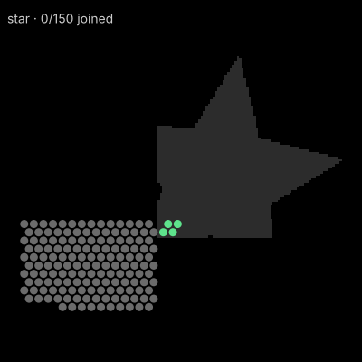 | 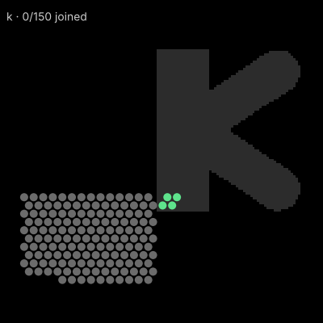 |

A recreation of Harvard's 2014 Kilobot experiment: 150 robots, each with only a map of the shape, a sense of distance from neighbours and a few simple rules, crawl round the edge of the group and stop where the shape needs them.
[Code](phase2/) · [Chapter 2](textbook/02-self-assembly.md)

## 4. A real bot to aim for: microbot v1 (Oct 23)

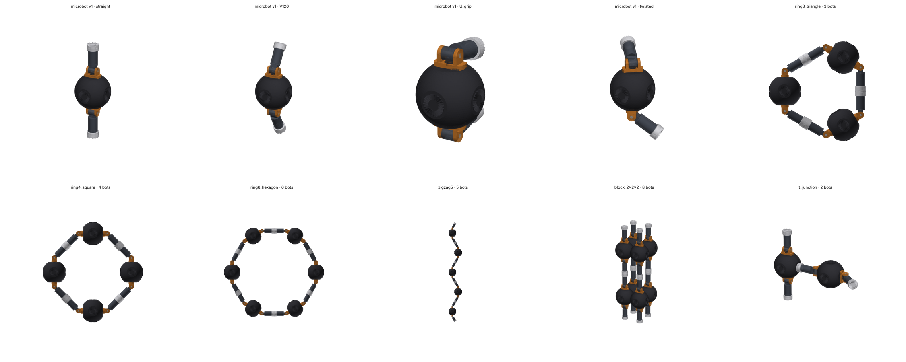

Kuan's CAD design: a ball with two 3-joint arms and side ports, so an arm tip of one bot docks into the side of the next. Top row: one bot in different arm poses. Bottom row: bots linked into a triangle, square, hexagon, zigzag, 2×2×2 block and T-junction.
[Design notes](assets/microbot_v1/DESIGN.md)

## 5. Going 3D: bots that never let go (Oct 25)

| The moves and rules | An arch, built and repaired |
| --- | --- |
|  |  |

Real programmable matter has to hold itself up, so every bot must stay linked while the swarm reshapes. Cube bots on a 3D grid slide or flip over each other, and a move is only allowed if nothing ends up hanging in the air. Cut the arch's bridge out and the spares climb back up and rebuild it.
[Code and notes](linking/) · [Linking 1](textbook/L1-linking.md)

## 6. In the browser, at 1,000 bots (Oct 26–27)

| Long bridge, mid-build | Built |
| --- | --- |
| 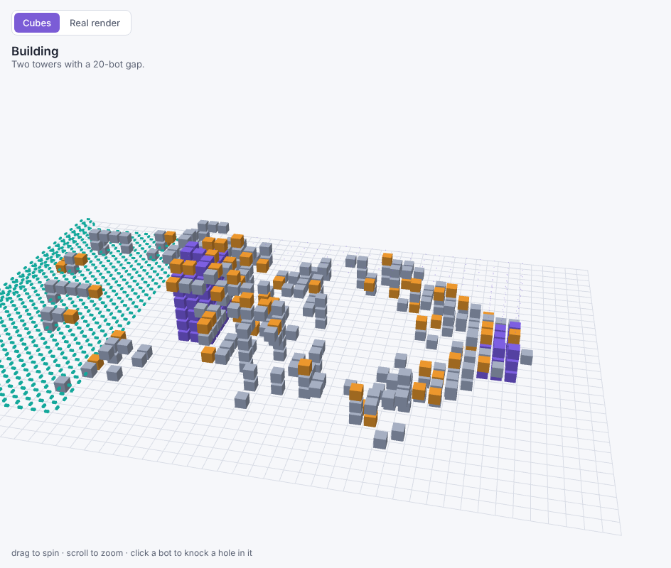 | 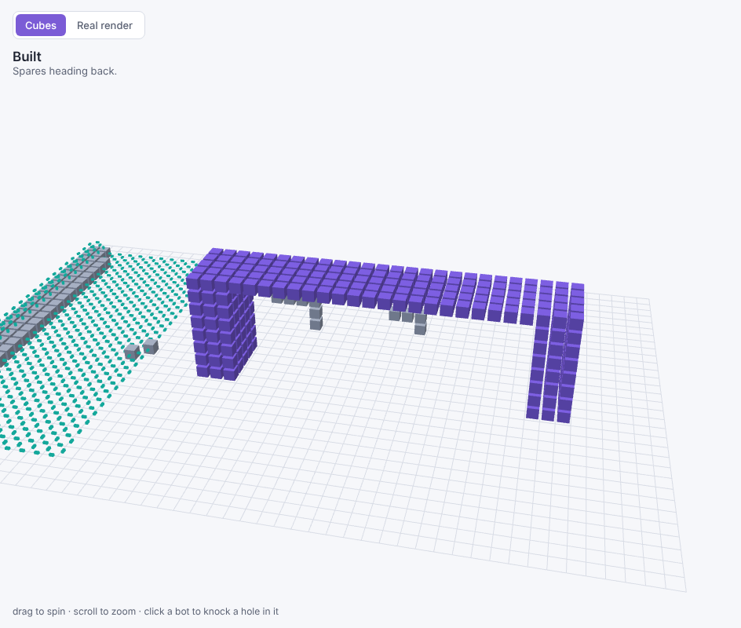 |

The same rules ported to a 3D web page anyone can open. Grey bots are free, purple ones are locked into the shape, orange ones are mid-flip, and the teal pad is where spares park. Click a bot to knock a hole in the structure and watch the swarm fix it.

| A hollow dome (832 bots) | Type something, get 3D letters |
| --- | --- |
| 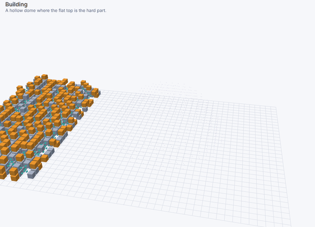 | 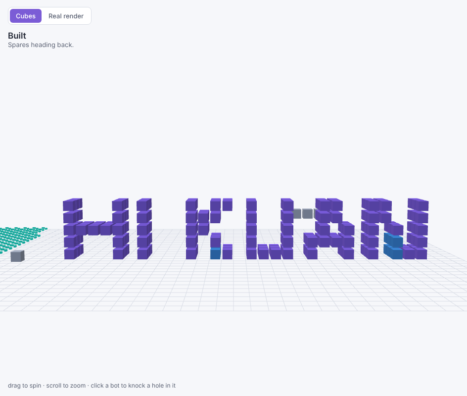 |

Harder shapes needed new behaviour: splitting the swarm between separate build sites, claiming holes so they don't get boxed in, and keeping out of spaces the shape will enclose (otherwise bots get sealed inside the dome).
[Sandbox](linking/sandbox/index.html) · [What was tried](linking/EXPERIMENTS.md)

## 7. Kuan's bot in the sandbox (Oct 27)

| Building with arm links | A table, built |
| --- | --- |
| 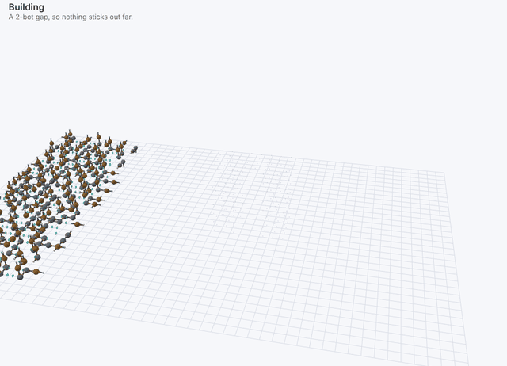 | 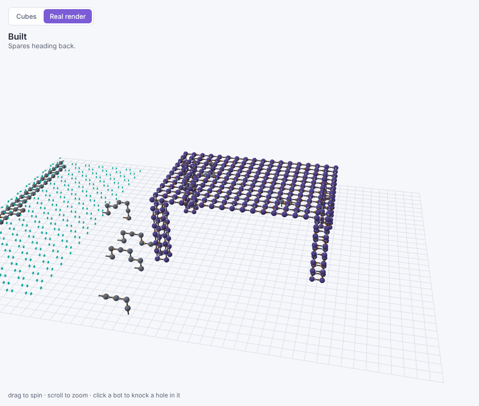 |

"Real render" draws every bot as microbot v1 and switches to its linking rules: a link is one bot's arm tip plugged into a side port of its neighbour, so bots that only touch aren't attached.

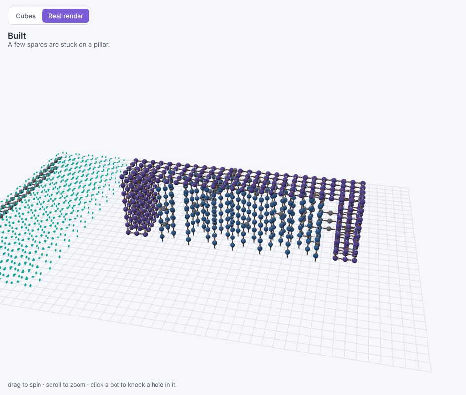

With **real connector strength** on, only one bot can stick out sideways before a connector would peel. The swarm plans support pillars (blue) under the long bridge's deck and builds them first.

## 8. A triangle truss (Oct 27)

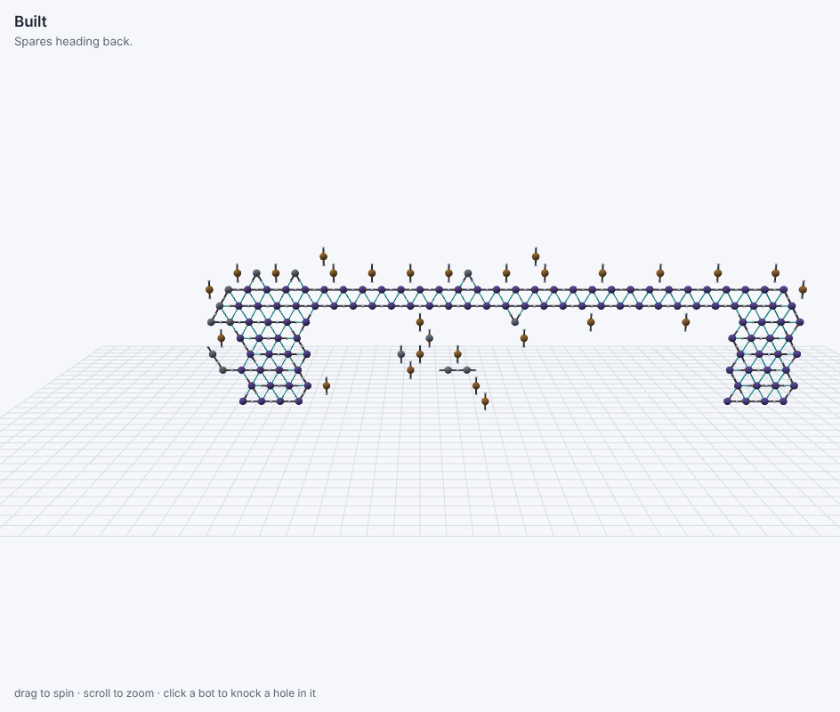

v1's links naturally form triangles and hexagons, so the bridge can also be built on a triangle grid: bots roll 60° around a shared neighbour, and arm pairs meet tip to tip.

## 9. From hand-written rules to a trained model (Oct 27)

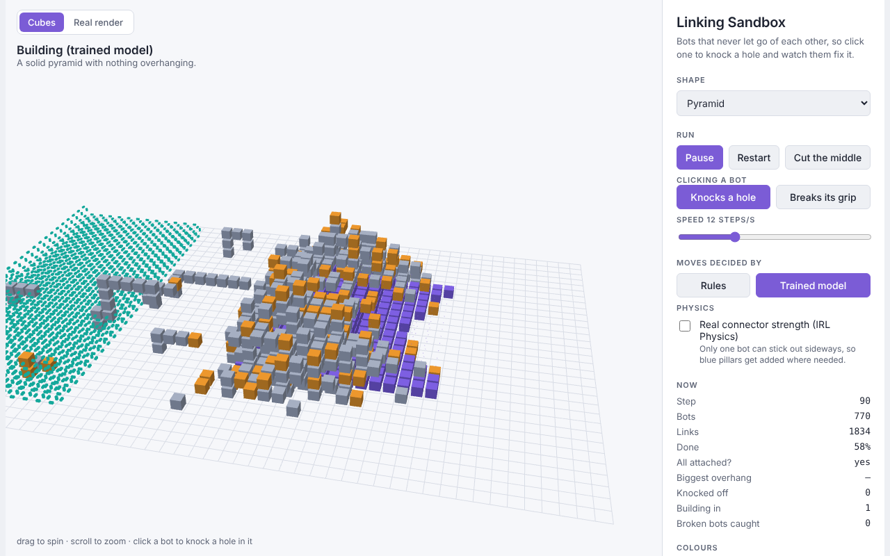

One small neural network (52,627 weights), copied into every bot. Each bot feeds it only what it can see nearby, and it picks one of 19 moves. It learned by copying the rules, then by driving the swarm itself and being corrected. It builds every shape, including ones it never saw in training, up to ~900 bots.
[Code](linking/learn/) · [Linking 2](textbook/L2-from-rules-to-a-model.md)

## 10. Making it local, and catching broken bots (Oct 28)

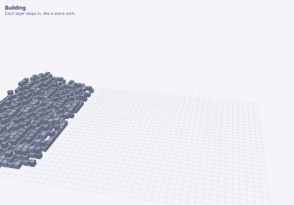

**The arch, as of today:** 902 bots build a curved stone-style arch where every layer steps in over the one below. Then a slice is cut out of the top and the spares climb back up and fill it. Every decision about which cell to fill next, and whether it's safe to let go, is now made locally.

- **No global layer:** each shape cell decides for itself when it's ready to be filled.
- **No global "will anything fall?" check:** every bot remembers which neighbour holds it up, and only moves once the bots it holds have somewhere else to hang. It has never dropped a bot in any test.
- **Arm-link jams fixed** for 7 of 8 shapes under real connector strength: bots can swivel their arms in place to link to more neighbours.
- **Broken bots:** click a bot to break its grip. It keeps falling off; after its second fall it works out it's broken and takes itself to a reject pad.

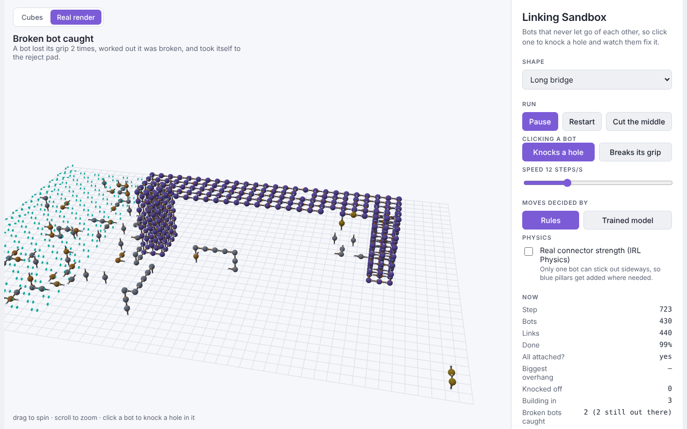

---

## Things nobody programmed (emergent behaviour)

Some of the most interesting moments were behaviours that came out of simple rules without anyone writing them in. Some helped, some were problems that then had to be fixed.

| What happened | Where | Helpful? |
| --- | --- | --- |
| **Scaffolding.** With real connector strength on and no plan for supports, spare bots sometimes piled up under the long bridge's deck and held it up while it was built, like scaffolding. Nobody told them to. It didn't happen every run (others got stuck around 93%), so a support planner was added to do on purpose what the swarm had stumbled into. | Sandbox, strength limit | Yes, and it inspired the support planner |
| **Cantilevers that hold.** Cut out the middle of the arch's bridge, and each half stays up, sticking out over nothing, because every bot is still linked back to its leg. | Linking, Python arch repair | Yes (though v1's real connectors couldn't hold that) |
| **Pillars with a pattern.** A simple arm rule (point both arms at something real, prefer vertical) made pillars alternate on their own between bots holding vertically and bots held sideways, and made decks run their arms along the deck. | Real render | Yes |
| **One big blob.** Before the swarm learned to split its work, everyone headed for the nearest place that needed bots, so the whole swarm moved as one mass while the far side of the shape waited. | Sandbox, two build sites | No, fixed by sharing work out |
| **Sealed in.** Bots crawled inside the dome to help, and the dome closed over them. | Sandbox, dome | No, fixed by keep-out zones (and later the readiness rule) |
| **Knots and hanging chains.** Spares hung off pillars and off each other in chains under the deck, each one holding the next, so nobody could let go first. | Sandbox, strength limit and arm links | No, mostly fixed by letting bots swivel their arms and back off when stuck |
| **Racing ahead.** Once each cell decided for itself when to fill, one leg of an arch could shoot up and grow the deck before the other leg existed, and then everyone had to walk back. | Python, readiness rule | No, fixed by waiting for nearby cells in the layer below |
| **A learned shortcut.** The trained model quietly learned "drift this way", because every training build sat in the same spot. It failed every build in the browser, where the shape was somewhere else. | Trained model | No, fixed by giving bots a compass |

---

## Next

Reinforcement learning: let the trained model try things and keep what works, to see whether it can beat the hand-written rules (for example, using fewer support pillars on the long bridge). Before that, a few shortcuts in the simulation need fixing. Both are in [Linking 2, Part 9](textbook/L2-from-rules-to-a-model.md).

Video versions of the early clips are in [`media/captures/`](media/captures/).
