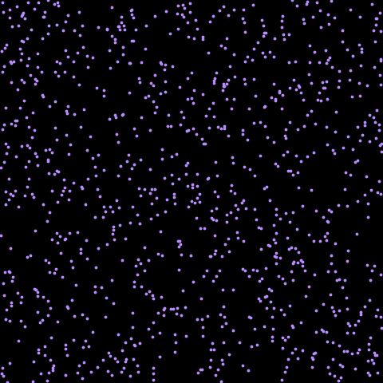

# Chapter 0: A random walk in NumPy and JAX

**Phase 0 · Code:** `phase0/random_walk_numpy.py`, `phase0/random_walk_jax.py`, `phase0/animate.py`, `phase0/checks.py`



This chapter builds the simplest possible swarm: dots that wander around a box at random. Nothing about it is smart yet. The point is the *tools*. Everything later in the project (flocking, shape-building, self-healing) uses exactly the ideas in this chapter: arrays, keys, `jit`, `vmap` and `scan`.

You only need basic Python for this chapter: variables, functions, `if` and `for` loops.

---

## Run it first

From the repo root, with `.venv` active (see the main README for setup):

```powershell
python phase0/random_walk_numpy.py     # prints the shape and a sanity check
python phase0/random_walk_jax.py       # same thing, in JAX
python phase0/checks.py                # runs all the Phase 0 checks
python phase0/animate.py --bots 1000   # opens a window with the animation
python phase0/animate.py --bots 1000 --save media/random_walk.gif
```

`checks.py` should end with `8/8 checks passed`.

---

## Part 1: The NumPy version

Open `phase0/random_walk_numpy.py`.

### 1.1 The swarm is a table of numbers (an array)

Each bot has a position: an x value (left–right) and a y value (up–down). Instead of a separate variable per bot, all positions live in **one table**: a row per bot, a column for x and a column for y. NumPy calls this table an **array**.

```python
pos = rng.uniform(0, BOX, size=(n_bots, 2))  # random starting spots
vel = np.zeros((n_bots, 2))                  # everyone starts still
```

An array's **shape** is its size. `(100, 2)` means 100 rows and 2 columns. You read it like this:

| Expression | Means |
| --- | --- |
| `pos[3]` | bot 3's position, both x and y (shape `(2,)`) |
| `pos[3, 0]` | bot 3's x |
| `pos[:, 0]` | every bot's x (the `:` means "all rows") |

Rows are numbered from 0, so the first bot is `pos[0]`.

There's a second table, `vel`, with the same shape. It holds each bot's **velocity**: how far it moves in x and y each step.

### 1.2 Change every bot at once, never one at a time

This is the most important idea in the chapter. Look at how a step moves the bots:

```python
pos = pos + vel
```

That one line moves **all** the bots. NumPy adds the two tables cell by cell: row 0 of `pos` plus row 0 of `vel`, row 1 plus row 1, and so on. The alternative, a loop, would look like this:

```python
for i in range(n_bots):        # don't do this
    pos[i] = pos[i] + vel[i]
```

Both give the same answer. The array version is 50–100 times faster, because NumPy hands the whole table to fast pre-compiled code instead of making Python handle each bot. It's like writing "column A = column A + column B" in a spreadsheet instead of editing every cell by hand.

This style is called **vectorization**. The rule for the whole project: whenever you're about to write "for each bot", write one rule for the whole table instead.

Notice that `simulate` *does* have a loop: `for _ in range(n_steps)`. That's fine. It loops over **time** (step 1, step 2, step 3…), which has to happen in order. It never loops over bots.

### 1.3 Random nudges and the normal distribution

```python
def step(pos, vel, rng):
    nudge = rng.normal(0.0, NOISE, size=pos.shape)  # one random nudge per bot per axis
    vel = MOMENTUM * vel + nudge
    pos = pos + vel
    return reflect(pos, vel)
```

`rng` is NumPy's random number generator, created once with `np.random.default_rng(seed)`. `rng.normal(0.0, NOISE, size=pos.shape)` makes a whole table of random numbers, the same shape as `pos`, so every bot gets its own nudge in x and in y.

The numbers come from a **normal distribution** (the bell curve):

- the first argument, `0.0`, is the centre: nudges are as likely to be negative as positive, so there's no drift in any direction
- the second, `NOISE` (0.05), is the spread: most nudges are smaller than 0.05, a few are bigger

### 1.4 Velocity and momentum: why the motion is smooth

If each bot just moved by a random nudge each step, it would jitter on the spot, because every step ignores the last one. Instead, the velocity has **memory**:

```python
vel = MOMENTUM * vel + nudge
```

With `MOMENTUM = 0.9`, each bot keeps 90% of the velocity it had, then adds a small nudge. So it mostly keeps heading the way it was going and turns gradually. That's why the dots drift in smooth curves. This is called a **correlated random walk**.

The 0.9 is a knob:

- closer to 0: no memory, so jittery
- closer to 1: lots of memory, so long, sweeping paths

### 1.5 Walls: reflecting with `np.where`

After moving, some bots end up past an edge of the box, which runs from 0 to `BOX` (10). `reflect` bounces them back in:

```python
def reflect(pos, vel, box=BOX):
    hit_low = pos < 0
    pos = np.where(hit_low, -pos, pos)
    vel = np.where(hit_low, -vel, vel)

    hit_high = pos > box
    pos = np.where(hit_high, 2 * box - pos, pos)
    vel = np.where(hit_high, -vel, vel)
    return pos, vel
```

Line by line:

1. `hit_low = pos < 0` compares **every** number in `pos` with 0 and gives a table of `True`/`False` with the same shape. `True` means "this bot crossed the left wall (in the x column) or the bottom wall (in the y column)".
2. `np.where(condition, a, b)` goes through the table cell by cell: where the condition is `True` it takes the value from `a`, otherwise from `b`. It's an `if` statement for a whole array.
3. `-pos` mirrors a position across 0: a bot at −0.3 goes to 0.3, the same distance on the inside.
4. `-vel` flips that part of the velocity, so the bot now heads away from the wall instead of straight back into it.
5. The same again for the far walls: `2 * box - pos` mirrors across `box`, so 10.3 becomes 9.7.

Because x and y are separate columns, a bot that hits the left wall only has its x flipped. Its y carries on unchanged, which is exactly how a real bounce works.

### 1.6 Frames: saving the whole history

```python
frames = []
for _ in range(n_steps):
    pos, vel = step(pos, vel, rng)
    frames.append(pos.copy())
return np.stack(frames)
```

An animation is a series of pictures called **frames**. After every step, a copy of `pos` goes into a Python list. `np.stack` then glues the 300 tables into one **3D array** with shape `(300, 100, 2)`:

| Axis | Size | Meaning |
| --- | --- | --- |
| 0 | 300 | which frame (time step) |
| 1 | 100 | which bot |
| 2 | 2 | x or y |

So `traj[50, 3]` is bot 3's position at step 50, and `traj[50]` is everyone's position at step 50.

`.copy()` matters: without it the list could end up holding references to an array that later changes, instead of a snapshot of each moment.

---

## Part 2: The JAX version

Open `phase0/random_walk_jax.py`. It produces the same kind of walk, but it's written the way every later phase will be written. JAX looks like NumPy but has stricter rules. The rules are what make it fast and parallel.

### 2.1 `jax.numpy` is a near copy of NumPy

```python
import jax.numpy as jnp
```

`reflect` is almost identical to the NumPy version: `np.where` became `jnp.where`. Most NumPy code carries over by changing `np.` to `jnp.`.

### 2.2 Arrays can't be edited in place

In NumPy you can change one cell directly: `pos[0, 0] = 5`. JAX doesn't allow that. You always make a **new** array instead. Most of the time you don't notice, because a line like `pos = pos + vel` already creates a new array and points the name `pos` at it. If you really need to change one cell, JAX's version is `pos = pos.at[0, 0].set(5)`, which returns a new array with that cell changed.

JAX works this way so it can safely reorder and parallelize calculations: if nothing is ever changed in place, no step can accidentally interfere with another.

### 2.3 Random numbers need a key

Computers can't make truly random numbers. They run a formula from a starting number (a **seed**) that produces numbers that *look* random. NumPy hides this and tracks the seed for you inside `rng`. JAX makes you hold it yourself, as a **key**:

```python
traj = simulate(jax.random.PRNGKey(0))   # 0 is the seed
```

The key rules:

- **The same key always gives the same numbers.** That's what makes runs reproducible.
- **So never use a key twice.** Before using randomness, **split** the key into fresh ones with `jax.random.split`.

Inside `simulate`, splitting happens in three places:

```python
key, start_key = jax.random.split(key)          # one key for the starting positions
...
key, step_key = jax.random.split(key)           # a fresh key every step
bot_keys = jax.random.split(step_key, n_bots)   # one key per bot
```

`jax.random.split(key)` turns one key into two: one to keep splitting later (`key`) and one to use now. `jax.random.split(step_key, n_bots)` turns one key into `n_bots` keys, one for each bot, so every bot gets its own different nudge.

### 2.4 Pure functions

A **pure function** behaves like a maths function: the same inputs always give the same output, and it does nothing else. It doesn't change variables outside itself, and it doesn't use hidden randomness.

Every function in this file is pure. That's why `step_one` takes `key` as an argument instead of generating randomness inside. JAX relies on purity to compile and parallelize safely. If a function secretly used `np.random` inside, JAX would generate that number once while compiling and then reuse the same "random" number forever.

### 2.5 `step_one`: write the logic for one bot

```python
def step_one(pos, vel, key):
    nudge = NOISE * jax.random.normal(key, shape=(2,))
    vel = MOMENTUM * vel + nudge
    pos = pos + vel
    return reflect(pos, vel)
```

This is the same physics as the NumPy `step`, but for **one** bot: `pos` and `vel` have shape `(2,)` (just this bot's x and y), and `key` is this bot's own key. `jax.random.normal(key, shape=(2,))` draws two numbers from the bell curve with spread 1, and multiplying by `NOISE` scales the spread down to 0.05.

Thinking about one bot is often easier than thinking about the whole table. That will matter a lot in later phases, when each bot looks at its neighbours and makes decisions.

### 2.6 `vmap`: run it on every bot at once

```python
step_all = jax.vmap(step_one)
```

`jax.vmap` ("vectorizing map") takes a function written for one item and returns a version that works on a whole batch. `step_all` takes:

| Argument | `step_one` expects | `step_all` takes |
| --- | --- | --- |
| `pos` | `(2,)` | `(N, 2)` |
| `vel` | `(2,)` | `(N, 2)` |
| `key` | one key | `N` keys |

It runs `step_one` on every row at the same time. It doesn't loop; it rewrites the maths to work on whole arrays, the same speed trick as Part 1.

This is the core idea of the whole project in one line: **every bot runs the same small program, independently.**

### 2.7 `scan`: repeating the step inside compiled code

The NumPy version repeats the step with a Python `for` loop. The JAX version uses `jax.lax.scan`:

```python
def tick(carry, _):
    pos, vel, key = carry
    key, step_key = jax.random.split(key)
    bot_keys = jax.random.split(step_key, n_bots)
    pos, vel = step_all(pos, vel, bot_keys)
    return (pos, vel, key), pos

_, traj = jax.lax.scan(tick, (pos, vel, key), None, length=n_steps)
```

How to read it:

- The **carry** is everything that changes from one step to the next and has to be passed along: positions, velocities and the key.
- `tick` takes the carry and returns two things: the **new carry**, and **what to save** from this step (here, the positions).
- `scan` calls `tick` `n_steps` times, feeding each new carry into the next call, and **stacks** everything saved into one array: `traj`, with shape `(n_steps, n_bots, 2)`, the same as `np.stack(frames)` in Part 1.
- The `_` arguments are things we don't need: `tick`'s second input (scan can feed a sequence of inputs, but we have none, hence `None`) and scan's final carry.

So `scan` is a `for` loop over time, written so that JAX can compile it as one piece.

### 2.8 `jit`: compiling for speed

```python
@partial(jax.jit, static_argnames=("n_bots", "n_steps"))
def simulate(key, n_bots=100, n_steps=300):
```

Normally Python runs code line by line, which is slow. `jax.jit` ("just-in-time compilation") makes JAX read the whole function once, turn it into optimized machine code, and reuse that code on every later call.

- **The first call is slow**: that's the compiling. Later calls with the same shapes are fast.
- **While compiling, JAX only knows shapes, not values.** That's why a Python `if pos[0, 0] < 0:` can't work inside a jitted function (JAX doesn't know the number yet) and why `reflect` uses `jnp.where` instead.
- **`static_argnames`** lists arguments that decide array *shapes*. `n_bots` sets the shape of `pos`, and `n_steps` sets the length of `traj`, so JAX must know them while compiling. Changing either one triggers a fresh compile.
- `@partial(...)` is a Python decorator. It just means "wrap `simulate` in `jax.jit` with these settings". `partial` comes from Python's built-in `functools` and fills in the `static_argnames` setting ahead of time.

---

## Part 3: The animation

Open `phase0/animate.py`.

### 3.1 Command-line options

```python
parser.add_argument("--bots", type=int, default=100, help="number of bots")
```

`argparse` (built into Python) reads options from the command you type, so `python phase0/animate.py --bots 1000` sets `args.bots` to 1000 without editing the code. Run `python phase0/animate.py --help` to see every option.

### 3.2 Simulate first, draw after

```python
traj = np.asarray(simulate(jax.random.PRNGKey(args.seed), args.bots, args.steps))
```

All the frames are computed first, in JAX, then converted to a NumPy array with `np.asarray`, because Matplotlib works with NumPy arrays.

### 3.3 How the animation works

Matplotlib draws one picture (a **figure**). The animation reuses that one picture and moves the dots for each frame:

```python
dots = ax.scatter(traj[0, :, 0], traj[0, :, 1], s=dot_size, c=DOT_COLOR)

def update(frame):
    dots.set_offsets(traj[frame])
    return (dots,)

anim = FuncAnimation(fig, update, frames=args.steps,
                     interval=1000 / args.fps, blit=True)
```

- `traj[0, :, 0]` means frame 0, every bot, column 0 (x). `traj[0, :, 1]` is the y values. Together they draw frame 0.
- `FuncAnimation` calls `update(frame)` once per frame, with `frame` = 0, 1, 2, …
- `dots.set_offsets(traj[frame])` moves every dot to that frame's positions in one go.
- `interval` is milliseconds per frame: 1000 / 30 ≈ 33 ms, so about 30 frames per second.
- `blit=True` tells Matplotlib to redraw only the dots, not the whole figure, which is faster. That's why `update` returns the dots.

### 3.4 Saving versus showing

```python
import matplotlib
if args.save:
    matplotlib.use("Agg")
import matplotlib.pyplot as plt
```

Matplotlib can draw into a window or off-screen. `"Agg"` is the off-screen mode, used when saving a file. It has to be chosen *before* `pyplot` is imported, which is why these imports sit inside `main()` instead of at the top of the file.

Saving uses Pillow for `.gif` files and ffmpeg (a separate free video tool) for `.mp4`. MP4 looks better on X; GIF works everywhere, including in this textbook.

---

## Part 4: What the checks prove

`phase0/checks.py` turns the roadmap's Phase 0 checks into code. Each check guards against a specific bug:

| Check | What a failure would mean |
| --- | --- |
| Shapes are `(300, 100, 2)` | frames were stacked wrongly, or a version has a bug |
| Every bot stays inside the box | the reflection in `reflect` is broken |
| Same seed gives identical results | something random isn't coming from the key (purity is broken) |
| Different seed gives different results | the seed isn't actually being used |
| Bots move independently | every bot got the same key, so they all took the same step |
| `jit` is faster | compiling isn't helping, which is worth investigating |

The independence check requires *most* bots' first steps to differ, not just two of them. That's deliberate: when every bot shares one key, they all get the same nudge, but the few that start near a wall bounce and end up moving differently. A check for "more than one unique move" would miss the bug. (Exercise 4 below lets you see this happen.)

The speed check calls `.block_until_ready()`. JAX hands control back to Python *before* the work is finished, so without this the timer would stop too early. A warm-up call before timing makes sure compile time isn't counted.

On one test machine, the compiled step for 10,000 bots was about 6× faster than the uncompiled one. Your machine's number will differ.

---

## Try this

Make each change by hand, **predict what will happen first**, then run `python phase0/animate.py --bots 1000` to see. Undo each change afterwards.

1. In `random_walk_jax.py`, set `MOMENTUM = 0.0`. Then try `0.99`. How does the motion change, and why?
2. Set `NOISE = 0.2`. What happens to the speed of the dots?
3. Break the walls: in `reflect`, comment out the two lines that flip `vel`. What do bots do when they hit a wall now? Does `checks.py` still pass? If it does, what check would you add to catch this bug?
4. Break the keys: in `tick`, replace `bot_keys = jax.random.split(step_key, n_bots)` with `bot_keys = jnp.stack([step_key] * n_bots)` so every bot gets the same key. Which check fails, and what does the animation look like?
5. Add gravity: in `step_one`, after the nudge, add `vel = vel + jnp.array([0.0, -0.002])`. Predict the result before running it.
6. Change the box from a square to a rectangle, 16 wide and 9 tall (handy for a widescreen video). Which functions and lines need to change?

---

## Check your understanding

Answer each in your own words before opening the answer.

<details>
<summary>1. What does the shape <code>(300, 100, 2)</code> mean, and what is <code>traj[50, 3]</code>?</summary>

300 frames, 100 bots, and 2 numbers (x and y) per bot. `traj[50, 3]` is bot 3's x and y at step 50.
</details>

<details>
<summary>2. Why is <code>pos = pos + vel</code> better than a loop over bots?</summary>

It does the same thing to every bot in one instruction, handled by fast pre-compiled code, so it's 50–100× faster. JAX's speed features (`jit`, `vmap`) also only work with this whole-array style.
</details>

<details>
<summary>3. What does <code>MOMENTUM</code> do, and what would 0 and 1 mean?</summary>

It's how much of the previous velocity each bot keeps. At 0 there's no memory, so each step is a fresh random nudge (jitter). At 1 the velocity never fades, so nudges keep piling up and the bots speed up. 0.9 gives smooth, curving paths.
</details>

<details>
<summary>4. Why does JAX make you pass random keys instead of using a global seed?</summary>

Because JAX functions must be pure: the same inputs must always give the same output. Passing the key in makes the randomness an input. That keeps runs reproducible and lets JAX compile and parallelize safely. Hidden randomness would get frozen into one value at compile time.
</details>

<details>
<summary>5. What happens on the first call to a jitted function, compared with later calls?</summary>

On the first call JAX traces the function (working with shapes, not values) and compiles it to optimized machine code, which is slow. Later calls with the same shapes reuse the compiled code and are fast. A call with new shapes, or new values for static arguments, compiles again.
</details>

<details>
<summary>6. Why can't you use a Python <code>if</code> on an array inside a jitted function?</summary>

While compiling, JAX only knows the array's shape and type, not its values, so it can't decide which branch of the `if` to take. `jnp.where` works because it computes both options and picks per cell.
</details>

<details>
<summary>7. What does <code>vmap</code> do to the input shapes of <code>step_one</code>?</summary>

It adds a batch dimension at the front: positions and velocities go from `(2,)` to `(N, 2)`, and one key becomes `N` keys. The function then runs on every bot at once.
</details>

<details>
<summary>8. In <code>lax.scan</code>, what is the carry, and why does the key have to be part of it?</summary>

The carry is everything that changes from one step to the next and must be passed along: positions, velocities and the key. The key has to be carried and split every step; otherwise every step would reuse the same key and get the same random numbers.
</details>

<details>
<summary>9. Why does <code>reflect</code> flip the velocity as well as the position?</summary>

Mirroring only the position puts the bot back inside, but its velocity still points at the wall, so it would cross again on the next step. Flipping that component of the velocity makes it head away, like a real bounce.
</details>

---

## Glossary

| Term | Meaning |
| --- | --- |
| Array | A table of numbers that NumPy and JAX can do maths on all at once |
| Shape | An array's size along each axis, e.g. `(300, 100, 2)` |
| Vectorization | Writing one rule for a whole array instead of looping over items |
| Normal distribution | The bell curve: most values near the centre, fewer far away |
| Correlated random walk | Random motion where each step remembers part of the last one |
| Seed | The starting number for a random number formula |
| Key | JAX's handle on randomness; split it, never reuse it |
| Pure function | Same inputs always give the same output, with no side effects |
| `jit` | Compile a function to fast machine code on its first call |
| Static argument | An argument JAX must know while compiling, because it sets array shapes |
| `vmap` | Turn a function for one item into one that runs on a whole batch |
| `scan` | Repeat a step function inside compiled code, carrying state forward and stacking outputs |
| Carry | The state that `scan` passes from one step to the next |
| Frame | One picture in an animation; here, every bot's position at one step |
