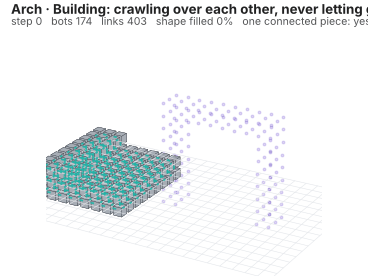
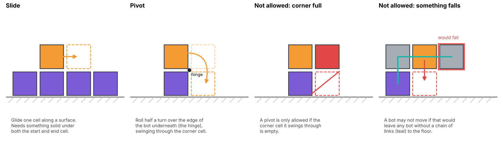

# Linking 1: Moving while attached

**Side track · Code:** `linking/lattice.py`, `linking/animate.py`, `linking/checks.py`, `linking/diagram.py`



In Chapter 2 the robots built a shape by stopping next to each other. That works on a table, where gravity holds everything down. It doesn't work for a structure that has to stand up in 3D: a wall, an arch or a tower only holds together if its bots are **attached** to each other. The Kilobots in the 2014 experiment never attached; real programmable matter has to.

That raises a hard question. If every bot must stay attached, how does anything move? This chapter builds a model where bots are cubes that link face to face, and can only move in ways that never let go: they **slide** along a surface or **pivot** over an edge. With just those two moves and two safety rules, a swarm builds a wall, a tower and an arch, then repairs the arch after its middle is cut out.

This chapter assumes Chapters 0–2. New ideas: **3D grids of yes/no cells**, **slide and pivot moves**, **connectivity**, and **distance fields**. It uses NumPy and SciPy rather than JAX, because each move here is a small yes/no decision about one cell, and plain Python is the clearest way to write those.

---

## Run it first

From the repo root, with `.venv` active (run `pip install -r requirements.txt` again first, which adds SciPy):

```powershell
python linking/checks.py                           # should end with 17/17 checks passed (~30 s)
python linking/animate.py --shape sheet            # a thin wall, one bot thick
python linking/animate.py --shape arch --repair    # build, cut, rebuild
python linking/diagram.py                          # redraws the move diagram below
```

Colours: **purple** = locked into the shape, **grey** = free (crawling or parked), **orange** = pivoting right now, **red** = removed by damage. **Teal bars** are links between bots. Faint purple dots are target cells still waiting for a bot.

---

## Part 1: The idea

### 1.1 Why attachment changes everything

In Chapters 1 and 2, a robot could move anywhere that wasn't already taken. Here that freedom is gone. A bot hanging off the side of a wall can't just fly to its destination; it has to **crawl** over the other bots, staying attached the whole way. It's like a group of climbers roped together: anyone can move, but only along the rock, and never in a way that leaves someone dangling with no rope.

Engineers call these systems **modular self-reconfigurable robots**. MIT's **M-Blocks** are real cubes that do exactly what this chapter simulates: they stick together with magnets and move by rolling over each other's edges, driven by a spinning flywheel inside.

### 1.2 The world is a 3D grid

Every bot is a cube that fills exactly one cell of a 3D grid, like a voxel in Minecraft. The grid is stored as a NumPy array of `True`/`False` values, one per cell:

```python
GRID = (24, 16, 14)            # grid size in cells (x, y, z)
```

`occ[x, y, z]` ("occupied") is `True` if a bot is in that cell. `z` is height, and `z = 0` is the layer sitting on the floor. Three other grids of the same shape are used everywhere:

| Grid | `True` means |
| --- | --- |
| `occ` | a bot is here |
| `target` | this cell is part of the shape we want |
| `locked` | a bot is here, it's part of the shape, and it will never move again |

NumPy lets you combine whole grids at once with `&` (and), `|` (or) and `~` (not). For example, `target & ~occ` is "target cells with no bot yet", computed for every cell in one line. You'll see this style all through the code.

### 1.3 Linked means sharing a face

Each cube has 6 faces, one in each direction:

```python
FACES = np.array([[1, 0, 0], [-1, 0, 0], [0, 1, 0],
                  [0, -1, 0], [0, 0, 1], [0, 0, -1]])
```

Adding a face direction to a cell gives the neighbouring cell on that side. Two bots that share a face are **linked**. Bots that only touch at an edge or a corner are not. The floor counts as one enormous bot that never moves, so anything sitting on it is linked to it.

---

## Part 2: The two moves



### 2.1 Slide

A bot glides one cell sideways. It's only allowed if there's something solid underneath both where it starts and where it ends, so it's always pressed against a surface. Think of a block sliding along a shelf.

### 2.2 Pivot

A bot rolls over the edge of the bot it's sitting on, from that bot's top face down onto its side face. The shared edge acts as a **hinge**, and the bot turns half a turn (180°) around it. Halfway round, it passes through the **corner cell** diagonally above the hinge, so that cell must be empty.

Pivots are how a bot gets around corners: from the top of a wall down its side, or from the floor up onto a step.

### 2.3 Finding the legal moves

`legal_moves(occ, p)` lists every cell the bot at `p` could reach. It tries every pair of directions: `d` is the way the bot wants to go, and `e` is "down" towards the surface it's pressing on. The two must be at right angles (`e @ d` is the dot product, which is 0 exactly when two directions are at right angles).

```python
for d in FACES:
    step = p + d                        # the cell next to me in direction d
    if not in_grid(step) or occ[tuple(step)]:
        continue                        # off the grid or full: can't go that way
    for e in FACES:
        if abs(e @ d) != 0:             # e must be at right angles to d
            continue
        under_here = p + e
        under_there = step + e
        if not solid(occ, under_here):
            continue                    # nothing to push against
        if solid(occ, under_there):
            moves.append(("slide", tuple(step), tuple(step)))
        elif in_grid(under_there):
            moves.append(("pivot", tuple(under_there), tuple(step)))
```

Read it as a picture. If there's a surface under me **and** under the next cell, I can slide into the next cell. If there's a surface under me but **not** under the next cell, I'm at an edge, so I can pivot over it into the cell below the next one, `step + e`, swinging through `step` on the way.

Each move is returned as `(kind, end cell, via cell)`. The **via** cell is the one the bot passes through. For a pivot it's the corner cell; for a slide it's just the end cell. The animation uses it to draw the roll, and the checks use it to prove no bot ever swung through another one.

Two small details:

- `tuple(step)` turns a NumPy array like `[5, 5, 1]` into `(5, 5, 1)`, which is what you need to look up one cell with `occ[...]`.
- `solid(occ, c)` is `True` for an occupied cell **or** for the floor at height `z = -1`. That's how bots on the bottom layer get to push against the floor.

---

## Part 3: The two rules

### 3.1 Never swing through a full cell

This is already built into `legal_moves`: a move is only listed if `step` is empty. The tick (Part 5) adds one more condition for when all bots move at once.

### 3.2 Never leave anything dangling

Picture a bot holding up an arm of three others. If it crawls away, the arm loses its only link and falls. So before keeping any move, the code checks that every bot still has a chain of links to the floor.

The check uses `ndimage.label` from SciPy. It looks at the grid and gives every **connected piece** its own number: all cells you can reach from each other by stepping face to face get the same number. If there's only one piece, everything is connected.

```python
def with_floor(occ):
    floor = np.ones(GRID[:2] + (1,), dtype=bool)
    return np.concatenate([floor, occ], axis=2)

def pieces(occ):
    labels, n = ndimage.label(with_floor(occ), structure=FACE_LINKS)
    return labels[:, :, 1:], n

def is_connected(occ):
    _, n = pieces(occ)
    return n <= 1
```

`with_floor` sticks one extra layer of `True` cells underneath the grid to stand for the floor. That's what makes two towers standing side by side count as one structure: they're both linked to the floor. `FACE_LINKS` tells `label` that only face neighbours count; edge and corner touches don't link.

The tick tries each move, checks, and undoes it if something would fall:

```python
self.occ[p] = False                 # pretend I moved
self.occ[c] = True
if is_connected(self.occ):
    ...                             # keep the move
else:
    self.occ[c] = False             # undo it
    self.occ[p] = True
```

---

## Part 4: Which way to crawl: the distance field

### 4.1 The idea

A free bot needs to know which of its legal moves gets it closer to an empty target cell. The answer is a **distance field**: a grid where every cell holds "how many moves from here to the nearest goal". A bot then just picks a move that lowers its number, like walking downhill.

The field is built in **waves**, the same breadth-first idea you used to check the gradient in Chapter 2. Goal cells get 0. Every cell one move away gets 1. Every cell one move from those gets 2, and so on:

```python
frontier = goal.copy()
dist[frontier] = 0
k = 0
while frontier.any():
    k += 1
    grown = ndimage.binary_dilation(frontier, structure=ONE_MOVE)
    frontier = grown & ~reached & passable
    dist[frontier] = k
    reached |= frontier
```

`binary_dilation` grows a set of cells outward by one step in every direction. It's like pressing a stamp around each cell. `ONE_MOVE` sets what "one step" means.

### 4.2 Two lessons that took real bugs to learn

**Paths can only run along surfaces.** In the first version, `passable` was every empty cell, so the field pointed straight through the air. Spare bots read it literally: they stacked themselves into a ladder, trying to climb towards a goal they could never reach. The fix is to allow only cells that touch something fixed (a locked bot or the floor):

```python
touching = ndimage.binary_dilation(with_floor(locked), structure=FACE_LINKS)[:, :, 1:]
passable = ~locked & touching
```

**Paths must include diagonal steps.** A pivot moves a bot diagonally (one cell across and one down). With face-only waves, the cell on top of a one-bot-thick wall was unreachable: none of its face neighbours touch anything fixed. The whole field came out as "unreachable" and every bot stood still. So the waves use `ONE_MOVE`, which includes the 12 edge-diagonal neighbours as well as the 6 face neighbours, matching what a slide or pivot can reach.

A second, weaker set of paths is added afterwards for bots perched on top of other free bots (high in the starting pile, say). Those paths lead them down onto a fixed surface, never up into the air.

---

## Part 5: One step of the swarm

`Swarm.tick()` gives every free bot, in a random order, one chance to move.

### 5.1 Classes, briefly

`Swarm` is a **class**: a bundle of data plus the functions that work on it. `self.occ`, `self.locked` and so on are the data; `tick`, `damage` and `done` are the functions (called **methods**). Inside a method, `self` means "this swarm". You create one with `swarm = Swarm(target)` and advance it with `swarm.tick()`.

### 5.2 What happens in a tick

1. **Pick the goal.** `goal_cells()` returns the empty target cells that are **ready**: on the floor, or with the shape cell under them already filled (an overhang, like a bridge deck, needs a filled cell beside it instead). A cell also waits until the shape cells in the layer below, within 3 cells, are filled. Every check looks only at nearby cells. Building bottom-up means a gap in the shape is always open from above, so a bot can pivot down into it. (`ready_cells()` has the details.)
2. **Build the distance field** towards those goal cells.
3. **For each free bot, in random order:** list its legal moves, keep the ones that lower its distance (plus, 30% of the time, ones that keep it level, so bots stuck behind each other can shuffle sideways), and try the best one. Keep it only if nothing falls.
4. **Lock arrivals.** A bot that lands on a goal cell is locked and never moves again.

### 5.3 Everyone moves at once

The code handles bots one at a time, but in the animation (and in a real swarm) they all move together. So a bot may only move into cells that were **empty when the step began**, and each move claims its cells so no other bot can use them that step:

```python
busy = self.occ.copy()                       # full at the start of the step
...
if self.locked[c] or busy[c] or busy[via]:
    continue                                 # someone is or was there this step
...
busy[c] = busy[via] = True                   # claim the cells I used
```

Without this, the checks found hundreds of pivots that swung through a cell another bot had only just left. In the code's one-at-a-time order that's fine, but if everyone moves together, two cubes pass through each other.

---

## Part 6: Damage and repair

`run(..., damage_region=...)` builds the shape, then waits for the spare bots to climb back down and **park** on the floor. A few steps later it calls `damage`:

```python
def damage(self, region):
    removed = self.occ & region
    self.occ &= ~region
    ...
    labels, n = pieces(self.occ)
    if n > 1:
        keep = labels == 1            # the piece that includes the floor
        ...                           # everything else falls away
```

First it deletes every bot in the region. Then it removes anything **no longer linked to the floor**, because in real life that part would drop. The floor layer is the first cell `label` visits, so its piece is always number 1.

After that, nothing special happens. The target has empty cells again, so `done()` is false. The goal and distance field point the parked spares back up the structure, and they rebuild.

Parking took a real bug to discover too. At first, spares stayed wherever they finished, which was usually perched on top of the shape. Cutting the top then took the spares with it, leaving nothing to repair with.

---

## Part 7: What the checks prove

`linking/checks.py` runs 17 checks:

| Check | Why it matters |
| --- | --- |
| A bot on top of one other bot can only pivot down its 4 sides | The move rules match the picture |
| A bot on the floor can slide | The floor works as a surface |
| A pivot is refused when the corner is full | Rule 1 |
| Sheet, arch and tower, 3 seeds each: fully built, in one piece every step | It works, and isn't luck from one random seed |
| Every move is one slide or one pivot, into cells that were empty | No teleporting, no passing through each other |
| No two bots ever share a cell | Basic sanity |
| Locked bots never move | The shape stays put once built |
| Sheet and arch: rebuilt after damage | Repair works |

---

## What is not local yet

Be honest about this one: two parts of this model use information no real bot would have.

1. **The distance field** is computed over the whole grid. A real swarm could spread it as a hop-count gradient through the links, as in Chapter 2.
2. **The "will anything fall?" check** looks at the whole structure. A real bot only knows its neighbours. Deciding locally whether it's safe to let go is a known hard problem in modular robotics.

They're global here on purpose, so you can study the move rules on their own. Both now have local versions in [Linking 2](L2-from-rules-to-a-model.md) (Part 8): a relayed signal plus a compass for the first, and a "holder tree" for the second.

---

## Try this

Predict what will happen before you run each one. Put each change back afterwards.

1. **No sideways shuffling.** Set `SIDEWAYS_CHANCE = 0` and build the sheet, then the arch. *(Sheet: still finishes, a bit slower. Arch: gets stuck just short of done, around 99%. Bots queued behind each other can't get past.)*
2. **Remove the safety rule.** In `tick`, replace `if is_connected(self.occ):` with `if True:` and build the arch. *(Pieces break off almost immediately and stay disconnected for nearly the whole run, and the build stalls well short of done.)*
3. **Face-only paths.** In `distance_field`, change both `structure=ONE_MOVE` to `structure=FACE_LINKS` and build the sheet. *(It stalls at about three-quarters full: the top of a one-bot-thick wall can only be reached by a diagonal pivot.)*
4. **Let columns race ahead.** Set `KEEP_LEVEL = False`, so a cell only waits for the cell under it, not its neighbours in the layer below. Build all three shapes. *(Everything still builds, about 10% slower: tall columns get ahead, and spares have to climb them or squeeze into the gaps between them.)*
5. **No floor.** In `pieces`, use `ndimage.label(occ, ...)` without `with_floor` and run the arch repair. *(The cut now loses over a hundred bots instead of 24, because the two legs are only connected through the bridge, so a whole side falls.)*
6. **Your own shape.** Add a function like `shape_sheet` that builds a staircase or a plus sign, add it to `SHAPES`, and run it. Does it build? If it gets stuck, where, and why?

---

## Check your understanding

<details>
<summary>1. Why can't these bots just move straight to an empty target cell?</summary>

Every bot must stay linked to the structure the whole time. A straight path would take it through the air with nothing to hold on to, so it has to crawl along surfaces using slides and pivots.
</details>

<details>
<summary>2. What's the difference between a slide and a pivot?</summary>

A slide moves one cell sideways along a surface that runs under both the start and end cells. A pivot rolls half a turn over the edge of the bot underneath, ending on that bot's side face. It's used to get around corners.
</details>

<details>
<summary>3. What is the "via" cell of a pivot, and why must it be empty?</summary>

It's the corner cell the bot swings through halfway round the hinge. If another bot were there, the rolling cube would hit it.
</details>

<details>
<summary>4. How does the code check that nothing will fall?</summary>

It adds a floor layer under the grid and uses ndimage.label to count face-linked pieces. If there's more than one piece, some bots have no chain of links to the floor, and the move is undone.
</details>

<details>
<summary>5. Why does the distance field only run along surfaces?</summary>

Bots can only move along surfaces. When the field pointed through the air, spare bots tried to follow it by stacking into ladders and got stuck.
</details>

<details>
<summary>6. Why do the distance waves include edge-diagonal neighbours?</summary>

A pivot moves a bot diagonally. Without diagonal steps, cells only reachable by a pivot (like the top of a one-bot-thick wall) looked unreachable.
</details>

<details>
<summary>7. Why is the shape built from the bottom layer up?</summary>

A bot needs a surface underneath to crawl on and pivot down from. Filling bottom-up keeps every gap open from above: a cell isn't ready until the one under it is filled, so the cell above a gap never fills first.
</details>

<details>
<summary>8. What is the `busy` grid for?</summary>

All bots move at the same time, so a bot may only use cells that were empty at the start of the step and not already claimed by another bot's move. Otherwise two cubes could pass through each other.
</details>

<details>
<summary>9. Why do spare bots park on the floor after building?</summary>

If they stay on top of the shape, damage to the top takes them with it and there's nothing left to repair with. On the floor they're safe and linked.
</details>

<details>
<summary>10. Which two parts of this model aren't local, and why does that matter?</summary>

The distance field and the "will anything fall?" check both look at the whole grid. A real bot only knows its neighbours, so both need local replacements before this could run on real hardware.
</details>

---

## Glossary

| Term | Meaning |
| --- | --- |
| Modular self-reconfigurable robot | A robot made of many identical modules that can rearrange how they're connected |
| Lattice | A regular grid; here, every bot fills exactly one cell |
| Voxel | One cell of a 3D grid (a 3D pixel) |
| Link | Two bots sharing a face, holding on to each other |
| Slide | Moving one cell along a surface |
| Pivot | Rolling half a turn over a shared edge to get around a corner |
| Hinge | The edge a pivoting bot rolls around |
| Via cell | The cell a bot passes through during a move |
| Connected piece | A group of cells you can reach from each other by stepping face to face |
| Distance field | A grid holding, for every cell, the number of moves to the nearest goal |
| Dilation | Growing a set of cells outward by one step |
| Class / method | A bundle of data with the functions that act on it / one of those functions |
| Cantilever | A part that sticks out sideways with nothing underneath, held up only by its links |
