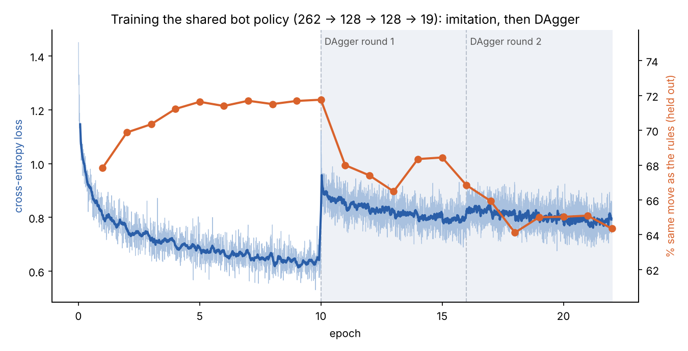

# Linking 2: From rules to a trained model

**Side track · Read before:** talking through the learned version with a collaborator · **Code:** `linking/learn/` (being built alongside this chapter)

In Linking 1 the swarm builds bridges, domes and letters, but every decision comes from rules someone wrote by hand. That is the first thing a machine-learning person will ask about: *what architecture, what policy?* Right now the honest answer is "none, it's rules." This chapter explains what it takes to turn those rules into a **trained model**, using the same ideas as Neural Particle Automata (NPA), so you can talk about it clearly.

The first version is built: see Part 7 for what happened, and `linking/learn/` for the code.

---

## Part 1: Rules versus a model

### 1.1 What the sandbox does now

Every step, each free bot:

1. looks up a **distance map**: how many moves from each cell to the nearest empty target cell;
2. lists its **legal moves** (slides and pivots);
3. picks a move that lowers its distance;
4. keeps the move only if nothing comes loose.

Steps 1 and 3 are the "brain," and both were written by hand. Worse, the distance map is computed over the **whole grid**, which no real bot could see.

### 1.2 What "a model" would mean

Replace step 3 (and eventually step 1) with a small **neural network** that every bot runs:

- **Input:** what this bot can see around itself, as a list of numbers.
- **Output:** a score for each move it could make.
- The bot picks the highest-scoring legal move.

Nobody writes the scores by hand. The network's numbers (its **parameters**, or **weights**) are adjusted by **training** until the bots build well.

Three words you'll hear constantly:

| Word | Meaning here |
| --- | --- |
| **Observation** | The input: what one bot sees this step |
| **Action** | The output: which move it makes |
| **Policy** | The rule that turns an observation into an action. "Learned policy" means the network *is* the rule. |

### 1.3 One network, every bot

All bots run **the same network** with the same weights. Each one just feeds it a different observation, because each one stands somewhere different. This is called **parameter sharing**, and it's exactly how NPA and the Growing NCA work: one tiny program copied into every cell or particle. It means:

- the network stays small (thousands of numbers, not billions);
- it works for any number of bots, since adding a bot doesn't change the network;
- every decision is **local**: a bot only uses what's near it.

---

## Part 2: What Kuan's NPA does

Neural Particle Automata (NPA) is the method Kuan has been training (the regrowing lizard). In outline:

- Each **particle** has a position and a small list of hidden numbers (its **state**).
- Each step, a particle **perceives** its neighbours: it blends their states, weighted by how close they are.
- One **shared MLP** (a small network, explained below) takes that perception and outputs a change: how to move and how to update its state.
- Particles update at random times rather than all at once, which makes the result robust.
- Training adjusts the MLP until the particles form the target shape and regrow it after damage.

Two differences from our sandbox matter:

| | NPA | Our sandbox |
| --- | --- | --- |
| Where bots can be | anywhere (continuous space) | grid cells only |
| What a move is | a small push in any direction | one of a few legal slides or pivots |
| Staying attached | not modelled | the hard rule everything depends on |

So we can borrow NPA's structure (shared network, local perception) but our **output** has to be "which legal move," not "push this way." That is the main thing to agree on with Kuan.

### 2.1 What an MLP is

A **multi-layer perceptron (MLP)** is the simplest neural network. It is just a few rounds of: multiply the inputs by a table of weights, add a bias, and squash out the negatives (a **ReLU**). For example:

```
262 numbers in  →  [weights 262×128] → ReLU  →  [weights 128×128] → ReLU  →  [weights 128×19]  →  19 scores out
```

That's about 52,600 weights in total. Training is the process of nudging those 52,000 numbers.

---

## Part 3: "Input and output format"

When people say the **format**, they mean: exactly which numbers go in, in what order, and exactly what the numbers coming out mean. Two pieces of code can only work together if they agree on it. It can always be changed later with a small translation layer, but agreeing early saves work.

Here is the format this project will start with. Every number below is a starting choice, and all of it can change after talking to Kuan.

### 3.1 Observation: 262 numbers per bot

| Part | Count | What it is |
| --- | --- | --- |
| Neighbourhood: occupied? | 125 | A 5×5×5 block centred on the bot: 1 if a bot is there, 0 if empty (cells outside the world count as empty; the floor row counts as occupied) |
| Neighbourhood: part of the shape? | 125 | Same block: 1 if that cell belongs to the target shape. Like the Kilobots, every bot is given the shape map. |
| Work signal | 7 | The "how far to the work" value at the bot's own cell and its 6 face neighbours (Part 4 explains how it becomes local) |
| Own state | 1 | 1 if the bot is locked into the shape, 0 if it's free |
| Compass | 4 | Direction to the nearest open shape cell, and how close it is, worked out from the shape map and the bot's own position (added later, see Part 7) |

### 3.2 Action: 19 slots

Every move a bot could ever make lands it in one of the 18 cells around it (6 sharing a face, 12 sharing an edge), or it stays put:

- slot 0: **stay**
- slots 1 to 6: the 6 face cells (slides)
- slots 7 to 18: the 12 edge cells (pivots)

The network outputs 19 scores. Before choosing, every slot that isn't a legal move right now is **masked**: its score is set to minus infinity, so it can never be picked. Moves that would leave anything unattached are masked too. So the network decides *which* safe move, and the safety rules still decide *what's* safe. This is called an **action mask**.

### 3.3 Reward (for the second stage of training)

| Event | Reward |
| --- | --- |
| A target cell gets filled | +1 |
| Every step that passes | −0.01 (so faster is better) |
| The shape is finished | +10 |

There is no penalty for breaking the structure, because the mask makes breaking it impossible.

---

## Part 4: Making the "work signal" local

The distance map is computed over the whole grid. A real bot can't do that. The fix is the **hop-count gradient** from Chapter 2 (the Kilobots):

- Bots on the edge of the unfinished shape broadcast 0.
- Every other bot listens to its neighbours and broadcasts one more than the smallest value it hears.
- After a few rounds, every bot holds roughly how many hops it is from the work, using only messages from neighbours.

That number is the "work signal" in the observation. It's not identical to the global distance map (it travels through bots, not empty air), so the trained policy has to cope with a noisier signal. That's part of what training is for.

The "will anything fall?" check was left global at first. Making *that* local is a separate, harder problem; Part 8 shows how it was done.

---

## Part 5: How it gets trained

### 5.1 Stage 1: imitation (copy the rules)

1. Run the hand-written rules on thousands of builds.
2. At every step, record each bot's observation and the move the rules picked.
3. Train the network to predict the rules' move from the observation. This is ordinary classification: the loss is **cross-entropy**, the same as image classification.

Result: a network that behaves like the rules, but **using only local information**. That alone is a real step, because the rules had a global map and the network doesn't.

This is called **imitation learning** or **behaviour cloning**. It's fast (minutes to hours on a free Colab GPU) and almost always works.

### 5.2 Stage 2: reinforcement learning (beat the rules)

Start from the imitation network and let it try things, rewarding it with the table in 3.3. The usual algorithm is **PPO** (Proximal Policy Optimization). Over many builds it nudges the weights toward moves that led to more reward.

This is where something new could appear: for example, with the real-strength limit on, does it learn to put support pillars down *before* the deck needs them, with nobody telling it what a pillar is? That's the interesting experiment, and it may take many tries or not work.

### 5.3 How we'll know it worked

| Check | Rules today | Target for the model |
| --- | --- | --- |
| Shapes finished | all 8 | all 8 |
| Ever disconnected | never | never (guaranteed by the mask) |
| Steps to build the long bridge | ~170 to 225 | same or fewer |
| Long bridge with real strength: support bots needed | 245 (planned by hand) | fewer, without a planner |

---

## Part 6: The plan

| # | Step | Time |
| --- | --- | --- |
| 1 | Port the simulation to Python/JAX, so thousands of builds can run in parallel | about a day |
| 2 | Build the observation, action and mask from Part 3, and write them up | half a day |
| 3 | Swap the global distance map for the local hop-count signal (Part 4) | half a day |
| 4 | Imitation training (done on a laptop CPU, ~6 minutes; see Part 7); next, load it into the sandbox with a "Rules / Learned" switch | done for the Python simulation |
| 5 | Reinforcement learning on the long bridge with real strength | 1 to 3 weeks, uncertain |

---

## Part 7: What happened when it was trained

The plan above was carried out on the Python version of the simulation (wall, arch and tower), with one change: the action-slot network shown in Part 2.1 (52,115 weights).

1. **Imitation alone** built the wall every time but finished the arch 2 times out of 5 and the unseen tower 3 times out of 5. The network agreed with the teacher on about 63% of decisions; the teacher is partly random, so that's close to the best possible.
2. **DAgger** (let the student drive, have the teacher say what it would have done, retrain) made the wall as fast as the teacher but didn't fix the others.
3. **A diagnostic**: giving the network the teacher's global map made it build everything, 15 out of 15. So the network wasn't too small. The problem was the work signal: passed only between touching bots, it takes long winding routes through the pile and points bots the wrong way.
4. **The fix**: relay the signal between bots up to 2 cells apart, like the Kilobots' infrared. Still local. Result: **15 out of 15**, including the tower it had never seen.

5. **In the browser it failed every build.** The browser puts the build site about 9 cells from the pile, too far for the 2-cell relay, and the model had quietly learned "drift in this direction" from the training layout, where every build was in the same spot. That's **overfitting to the layout**.
6. **The fix**: a compass, 4 more inputs giving the direction to the nearest open part of the shape, worked out from the shape map and the bot's own position (the Kilobots had both). Now 262 inputs. Result: every training shape, plus eight bigger shapes it had never seen, up to about 900 bots, built every time.

The lesson worth remembering: when a learned policy fails, test whether it's missing *information* or missing *capacity* before making the network bigger. Here one diagnostic run answered that. The second lesson: test in a setting that differs from training (here, a different layout) before trusting a result.

---

## Part 8: Making the rest local

After Part 7, two things were still global: which cells are open for filling ("the layer being built"), and the "will anything fall?" check. Both are local now, in the Python environment and in the browser sandbox.

### 8.1 Which cells to fill: the readiness rule

Before, the whole swarm agreed on one number, the lowest unfinished layer. No real bot could know that. Now each shape cell decides for itself, by looking at nearby cells only. A cell is **ready** if:

- it's on the floor, or
- the shape cell under it is already filled, or
- for an overhang (like a bridge deck, with nothing of the shape underneath), a filled bot sits beside it;
- **and** every shape cell in the layer below, within 3 cells, is filled.

The last line matters more than it looks. Without it, one tower of a dome races ahead of the support pillars inside, closes over the top, and the bots that still need to get inside can't. Looking 2 cells around fixed most runs; 3 cells (about the Kilobots' infrared range) fixed all of them.

A nice side effect: different parts of the shape can grow at different speeds. With this rule alone (before the holder tree below), most browser shapes built faster than with one global layer, for example the long bridge in about 125 steps instead of 170 to 225.

### 8.2 Will anything fall? The holder tree

Every bot remembers one thing: its **holder**, one linked neighbour that holds it up (or the floor). Following holders from any bot leads, step by step, down to the floor, like a family tree with the floor at the root. Bots locked into the shape only ever hang from other locked bots, so once a chain reaches a locked bot it is safe for good.

The rule for moving:

1. A bot that holds nobody can always move.
2. A bot that does hold someone must first hand each of them over to another neighbour. The new holder must be one whose own chain reaches the floor (or a locked bot) **without passing through the bot that wants to leave**.
3. To find that out, the question is passed up the chain, one bot at a time, at most 16 bots. If the answer doesn't come back in time, the answer is "not sure", so the bot stays.
4. After moving, the bot picks any linked neighbour as its new holder (a locked one if it can).
5. Every step, bots switch to a neighbour with a shorter chain if there is one, so chains stay short.

Why it's safe: before a bot leaves, nobody's chain runs through it any more, and every chain still ends at the floor. So nothing can come loose. In every test run, across every shape and both bot models, nothing ever did.

The cost: it's more cautious than checking the whole structure. A bot sometimes stays put even though moving would have been fine, because it can't *prove* it locally. Builds take somewhat longer: in Python the rules build the arch in about 100 to 150 steps instead of 80 to 90, and the long bridge in the browser takes about 200 steps instead of 125.

### 8.3 The arm model: swivelling in place

With Kuan's arm links, a bot is only linked to the neighbours its arms point at (or that point at it), so many bots have just one link. Under the real-strength limit that caused the old jam: bots under a deck hung off each other in chains, and nobody could let go first.

Two changes fixed most of it:

- **Swivel:** a free bot may turn its arms to another axis without moving, as long as it stays linked to its holder and to every bot it holds. It picks the axis that links it to the most neighbours. More links means more ways to hand someone over, so fewer bots get stuck holding someone.
- **Back off when jammed:** if nothing has been locked in for a while, hanging bots spend a few steps heading for the floor. The chains come apart from their free ends, and the bots try again.

Result: arms plus real strength went from finishing 0 of 8 shapes to 7 of 8 every time. The big arch still jams in some runs.

### 8.4 Broken bots: noticing repeated failure

What if a bot's connector is faulty? It keeps getting placed, falling off, and getting replaced: the swarm would rebuild the same section forever without noticing. In the sandbox you can click a bot to break its grip and watch this happen.

Two local rules catch it:

- **Each bot counts its own falls.** A bot that has lost its grip twice decides it is broken and rolls off to a reject pad, where nobody uses it again. It knows this about itself, so no one else has to work it out.
- **The bots around a spot count how often it has come apart.** If different bots keep failing at the same spot, the spot is the problem (a missing support, say), not the bot.

The general idea, from fault-tolerant swarm robotics: **when the same work keeps getting undone, that repetition is the signal**. Blame the bot if it's the same bot every time, and the spot if it's a different bot every time.

### 8.5 The training curve



The blue line is the loss (lower means the network predicts the rules' move better). The orange dots show how often it picks the same move as the rules on decisions it never trained on. In the shaded DAgger rounds the loss jumps up, because new, harder data arrives: situations the network got itself into, which the rules never would. Agreement on the rules' own runs dips a little at the same time. What matters is that it builds, and it does: wall, arch and tower, every time.

---

## Questions to ask Kuan

1. Does your NPA code take one list of numbers per particle and output one action per particle? Could the output be "pick one of 19 moves" instead of a direction?
2. What does a particle see in yours: just neighbours within some radius? How big a radius?
3. How do you train it: copying a target, or trial and error? What's your loss or reward?
4. Do you keep hidden state per particle between steps? (Ours has none yet. Adding some could help bots remember what they were doing.)
5. Would you rather we plug the bridge into your training code, or keep two pipelines and compare?

---

## Check your understanding

<details>
<summary>1. What is the difference between the sandbox's rules and a learned policy?</summary>

The rules were written by hand and use a map of the whole grid. A learned policy is a neural network whose weights were found by training, and it only sees what's near each bot.
</details>

<details>
<summary>2. Why does every bot use the same network?</summary>

Parameter sharing: one small network copied into every bot, like NPA and NCA. It keeps the model small, works for any number of bots, and keeps every decision local.
</details>

<details>
<summary>3. What does "input and output format" mean, and can it change later?</summary>

Exactly which numbers go in (the observation) and what the numbers coming out mean (the action). It can change later with a small translation layer; agreeing early just saves work.
</details>

<details>
<summary>4. Why can't the network break the structure?</summary>

Action masking: illegal moves and moves that would leave anything unattached get a score of minus infinity before the bot chooses, so they can never be picked.
</details>

<details>
<summary>5. What is imitation learning, and why do it first?</summary>

Training the network to copy the rules' choices from local observations. It's fast, reliable, and gives a working local policy to start reinforcement learning from.
</details>

<details>
<summary>6. What part is still not local?</summary>

The crawl map the hand-written rules use (the trained model doesn't need it: it uses the relayed signal and the compass) and the support-pillar planner. The layer choice and the "will anything fall?" check are local now (Part 8).
</details>

<details>
<summary>7. Why can't a bot move if it is someone's holder, even when moving would be safe?</summary>

It only knows about its neighbours and what it can learn by asking up a chain of at most 16 bots. If it can't prove the bots it holds have another way down to the floor, it stays. Cautious, but it never drops anything.
</details>

<details>
<summary>8. How does the swarm catch a bot with a faulty connector?</summary>

The bot counts its own falls. After two, it decides it's broken and takes itself to the reject pad. If different bots keep failing at the same spot instead, the spot is the problem, not the bot.
</details>

---

## Glossary

| Term | Meaning |
| --- | --- |
| Model | A neural network with trained weights |
| Weights / parameters | The numbers inside a network that training adjusts |
| Observation | What one bot sees in one step, as a list of numbers |
| Action | What a bot decides to do |
| Policy | The mapping from observation to action |
| MLP | Multi-layer perceptron: layers of multiply, add, ReLU |
| ReLU | Replace negative numbers with 0 |
| Parameter sharing | Every bot runs the same network |
| Action mask | Blocking illegal choices before the bot picks |
| Imitation learning / behaviour cloning | Training a network to copy an existing set of decisions |
| Cross-entropy | The usual loss for "pick one of these options" |
| Reinforcement learning (RL) | Training by trial and error with rewards |
| PPO | A common, stable RL algorithm |
| Hop-count gradient | A distance passed bot to bot, one more than the smallest neighbour's value |
| NPA | Neural Particle Automata: one shared network in every particle, perceiving its neighbours |
| Readiness rule | A shape cell opens for filling once the cells under it (and nearby in the layer below) are filled |
| Holder | The one linked neighbour (or the floor) a bot counts on to hold it up |
| Holder tree | Every bot's holder, together: chains that all lead down to the floor |
| DAgger | Let the student drive, have the teacher label what it would have done, retrain |
| Livelock | Bots busy moving but making no progress, like two people stepping the same way in a corridor |
